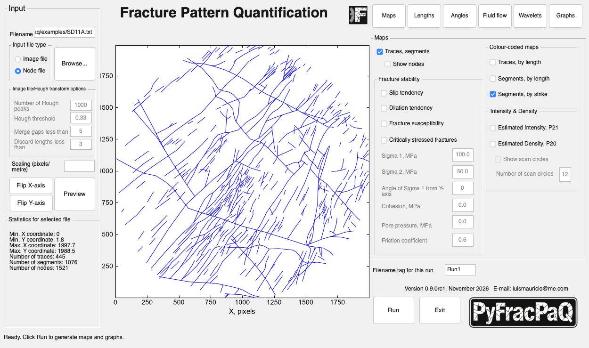

<p align="center">
  
</p>

# PyFracPaQ

**Analyse and visualise two-dimensional fracture networks directly in Python.**

PyFracPaQ brings together length and orientation measurements, circular sampling, connectivity, crack tensors, permeability estimates, fracture stability and multiscale analysis. It ports the interface and methods of **FracPaQ MATLAB 2.8**, with the approved scientific corrections described in the documentation. MATLAB is not required to run the application.

**Version:** 0.9.0rc1 (prerelease) · **Python:** 3.13 · **Contact:** [luismauricio@me.com](mailto:luismauricio@me.com)

[User manual — English](docs/manual/pyfracpaq-user-manual-en.pdf) · [User manual — Portuguese (Brazil)](docs/manual/pyfracpaq-user-manual.pdf) · [LaTeX sources and build instructions](docs/manual/README.md)



## What you can analyse

| Tab | Features |
| --- | --- |
| **Maps** | Traces and nodes; length- and strike-coloured maps; estimated intensity P21 and density P20; slip/dilation tendency, fracture susceptibility, critically stressed fractures and Mohr diagrams. |
| **Lengths** | Histograms, log-log distributions, MLE fits, length–angle cross-plots, map-edge censoring, block areas and a segment-length variogram. |
| **Angles** | An angle histogram and an equal-area rose diagram, with length weighting and a mean-vector reference. |
| **Fluid flow** | I/Y/X topology, crack tensors and a permeability projection with fixed or scaled apertures. |
| **Wavelets** | Two-dimensional Morlet or Mexican Hat analysis with configurable scales and anisotropy. |
| **Graphs** | Length, angle, P21 and P20 profiles along a line, and attribute profiles against signed distance from that line. |

**Inputs:** tab-delimited TXT files containing X/Y pairs; linear SVG geometry grouped by colour; eight-bit grayscale JPEG/TIFF images. Complementary tools provide image preprocessing, Move conversion and Wavelet analysis of an existing raster.

## Get started

Clone the repository, or select **Code → Download ZIP** and extract the folder. Open the folder containing `run_gui.py` and `requirements.txt`.

With Python 3.13 on macOS:

```bash
python3.13 -m venv .venv
.venv/bin/python -m pip install -r requirements.txt
.venv/bin/python run_gui.py
```

Alternatively, run `.venv/bin/python -m pyfracpaq` from the same folder.

Only the libraries need to be installed. **You do not need to install the PyFracPaQ package**, run tests or obtain the MATLAB distribution. Once the environment is ready, analyses run locally without an internet connection.

### Miniforge

```bash
conda create -n pyfracpaq python=3.13 pip
conda activate pyfracpaq
python -m pip install -r requirements.txt
python run_gui.py
```

### VS Code

Open the project folder and use **Python: Select Interpreter** to select the Python executable in `.venv` or your Miniforge environment. Run `run_gui.py`, or use one of the supplied Run and Debug configurations. The Python extension supports execution; Python Debugger is required for the debugging configurations.

CPython 3.13.18 and Miniforge/Python 3.13.13 have been checked on macOS arm64. Windows and Linux remain subject to future testing by the maintainer. Detailed preparation instructions are included in the [English manual](docs/manual/pyfracpaq-user-manual-en.pdf).

## First example: SD11A

1. Open `examples/SD11A.txt` as a **Node file** and leave the scaling field blank.
2. Click **Preview**: the statistics should show **445 traces, 1076 segments and 1521 nodes**.
3. Select the analyses in the tabs, set a filename tag and click **Run**.
4. Inspect the figures, tables and messages. Parameters and interpretation are explained in the [user manual](docs/manual/pyfracpaq-user-manual-en.pdf).

SD11A is supplied unchanged, with its original attribution and provenance preserved. Without physical calibration, its results are in pixels. Figures and tables are written to the working directory; reusing a tag replaces the same filenames. SVG conversions are written beside the SVG input. Keep separate working folders and preserve the original inputs.

## Manuals and methods

The illustrated manuals cover all 30 analytical features, controls, theory, formulae, outputs, interpretation limits and complementary tools, using SD11A as the main worked example:

- [English PDF](docs/manual/pyfracpaq-user-manual-en.pdf) and [LaTeX source](docs/manual/pyfracpaq-user-manual-en.tex).
- [Brazilian Portuguese PDF](docs/manual/pyfracpaq-user-manual.pdf) and [LaTeX source](docs/manual/pyfracpaq-user-manual.tex).
- [Build instructions for XeLaTeX/TeXStudio](docs/manual/README.md).

The English edition follows the application's wording, including **colour**, **centre** and **normalisation**. Interface labels and filenames are retained as used by the application. A [quick Markdown guide](docs/user-guide.md) and [example descriptions](examples/README.md) are also available in Brazilian Portuguese.

## Interpretation and accepted differences

The mapped network is two-dimensional. Permeability and stability estimates depend on the physical parameters supplied; they do not replace a complete flow simulation or a three-dimensional reconstruction. A rose diagram describes orientation, not flow direction. MLE fits and their Monte Carlo rates do not establish that a distribution is true.

The port incorporates approved corrections to censoring, connectivity, Wavelets, blocks, MLE, stability and circular sampling. Some legacy conventions are deliberately preserved. The manuals distinguish those decisions from the original results. Version 0.9.0rc1 identifies this Python port; 2.8 identifies the MATLAB reference. [Release notes (Portuguese)](docs/release-notes.md).

## Using and developing the code

The usage ZIP excludes tests, audit reports and internal tools, while retaining the application, resources, requirements, examples and both manuals. The full clone preserves the development material for maintenance and traceability. It is not run automatically or required to use the application.

For development, see `docs/development.md` and `requirements-dev.txt` in the full repository. Automatic test discovery in VS Code is disabled by default.

## Credits and licence

Based on FracPaQ by David Healy and collaborators. Reference: [Healy et al. (2017), *FracPaQ: A MATLAB toolbox for the quantification of fracture patterns*](https://doi.org/10.1016/j.jsg.2016.12.003).

[MIT licence](LICENSE) · [Third-party attributions and notices](THIRD_PARTY_NOTICES.md).
