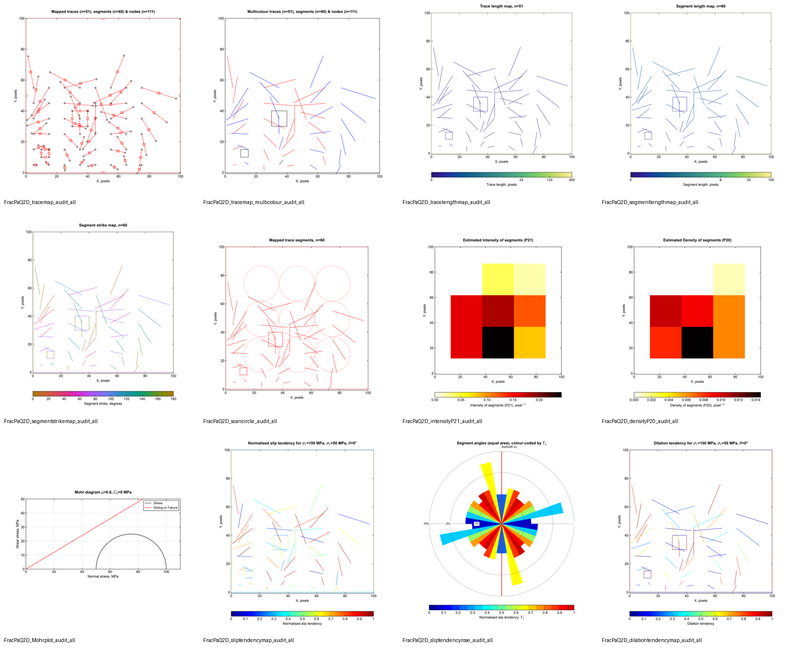
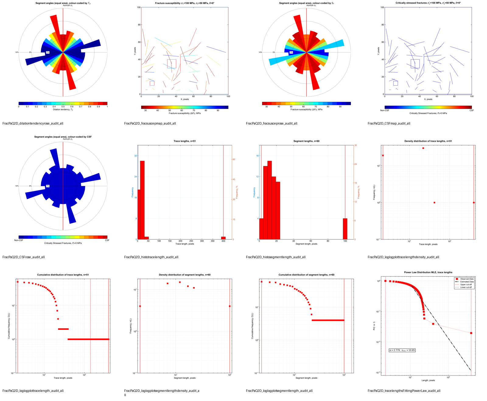
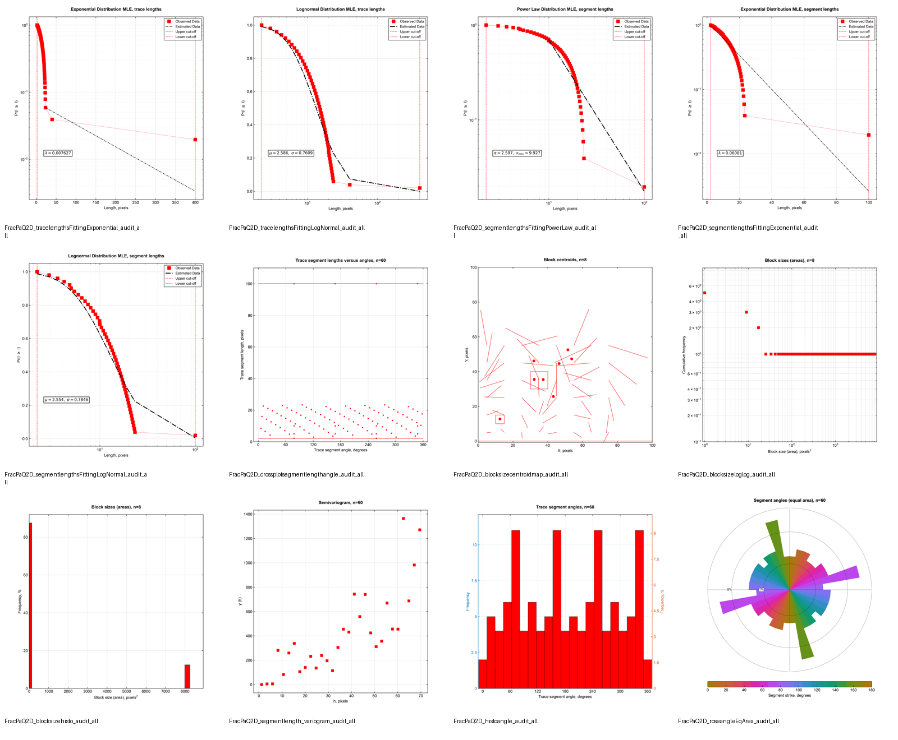
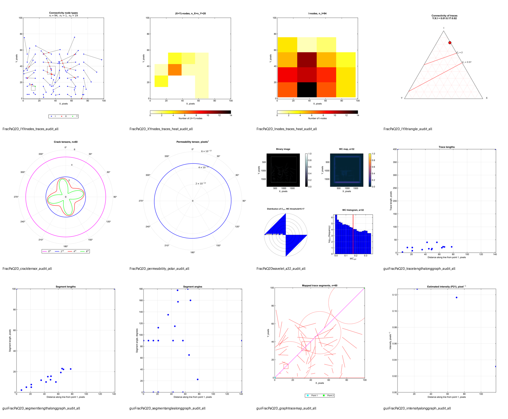
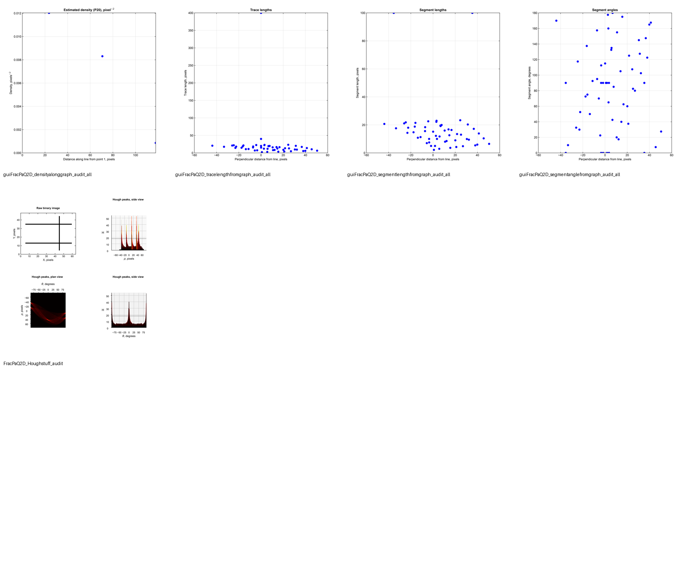

# Galeria da auditoria S16

53 nomes de figuras Python; miniaturas para revisão. Não são imagens usadas no cálculo de SSIM. Capturas nativas/contextos e limites estão no catálogo e family-audit.json.

