# Candidatos finais desta rodada

**S16-04 permanece aberta.** Miniaturas servem apenas para inspeção; SSIM usa os PNGs completos sem transformação.

[Estado e falhas por região](status.json) · [Comparação principal](region-comparison.json) · [Contextos e controles](additional-region-comparison.json)

## Folha 1

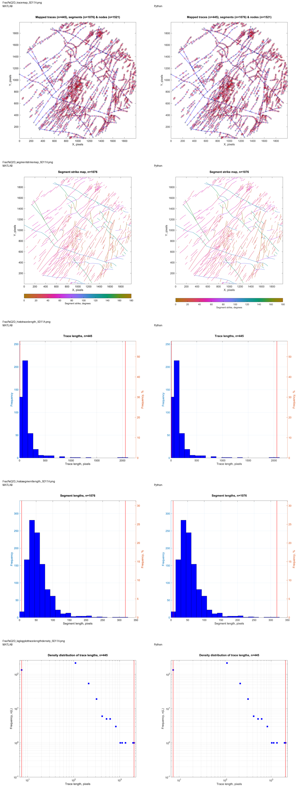

## Folha 2

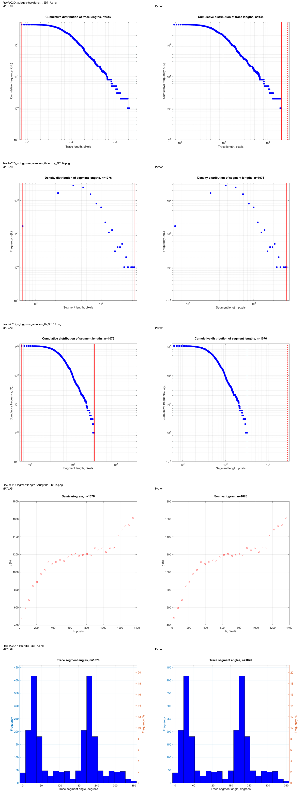

## Folha 3

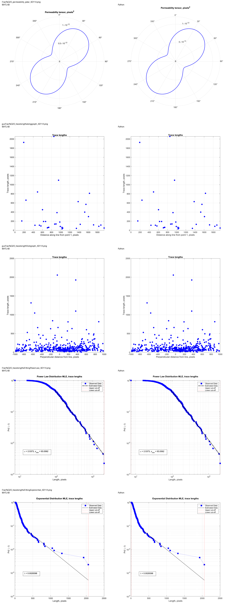

## Folha 4

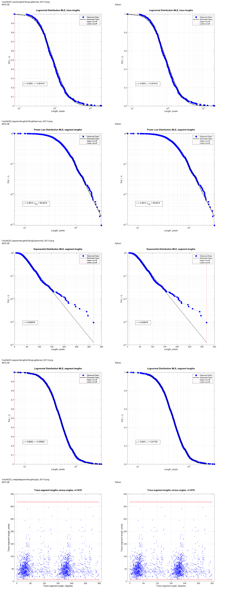

## Folha 5

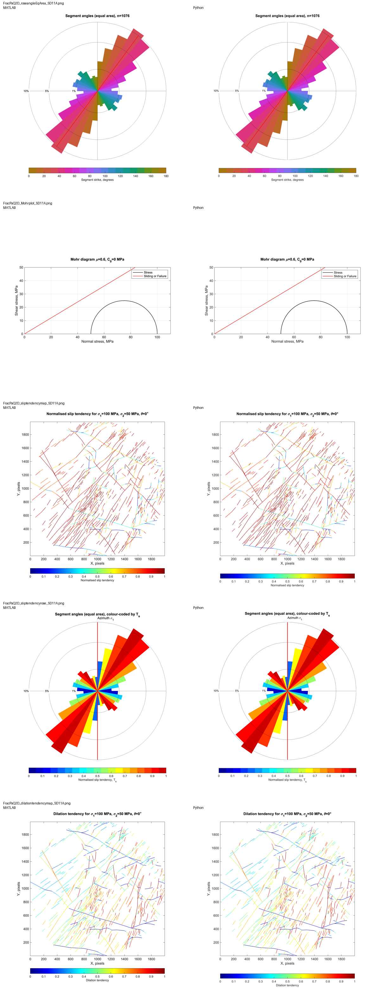

## Folha 6

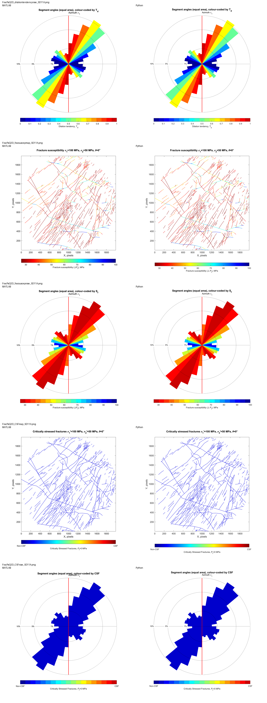

## Folha 7

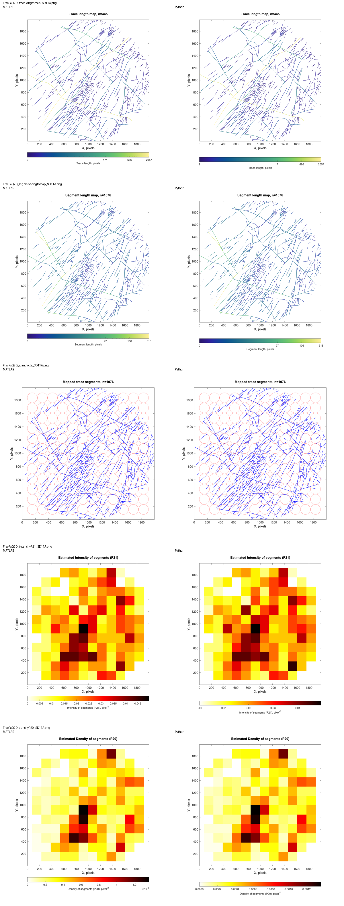

## Folha 8

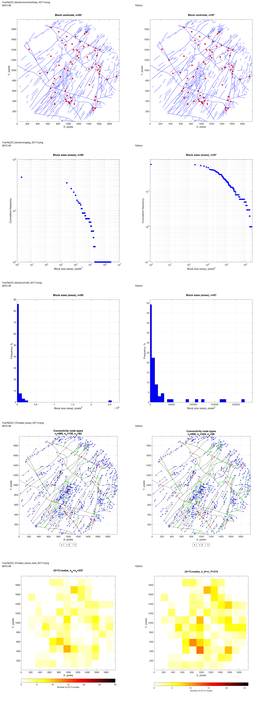

## Folha 9

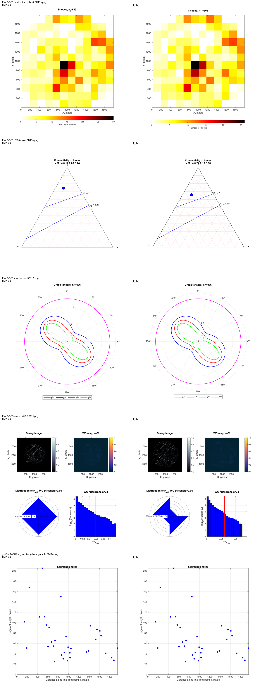

## Folha 10

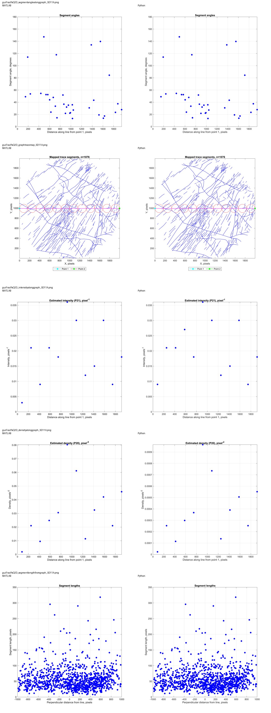

## Folha 11

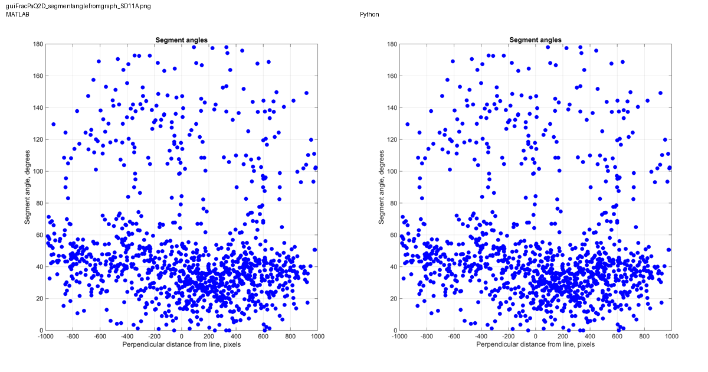
