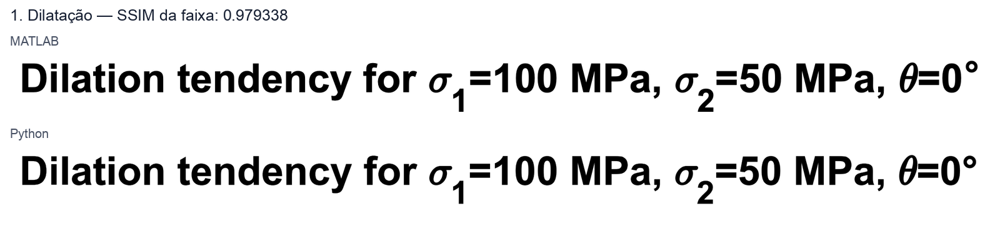
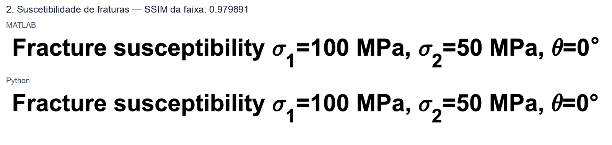
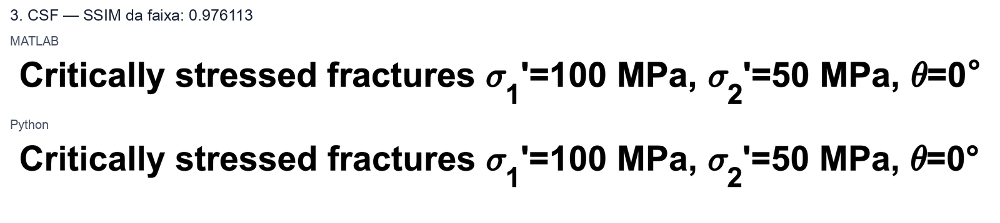
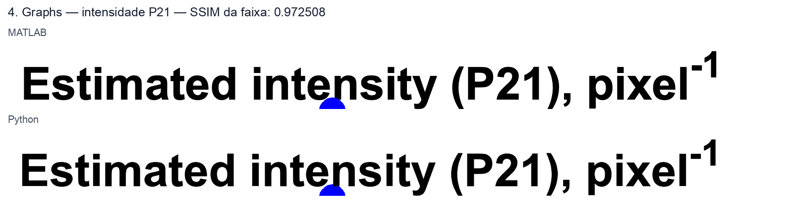
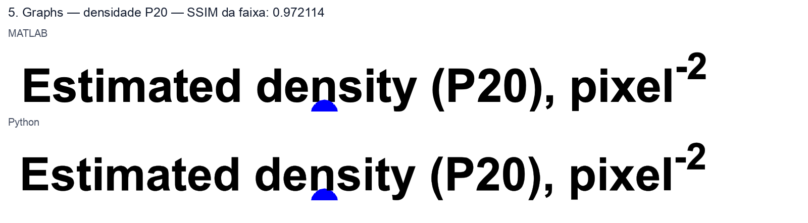
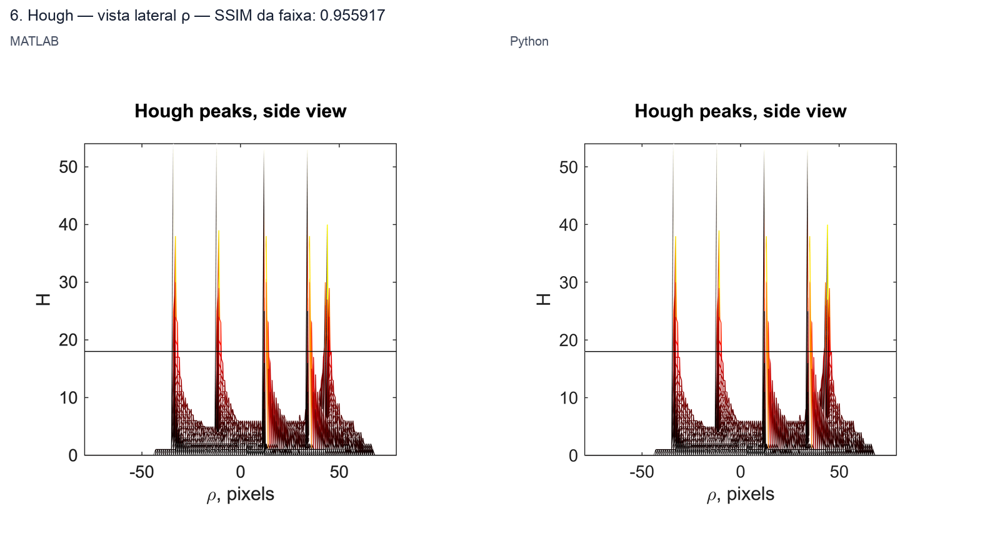
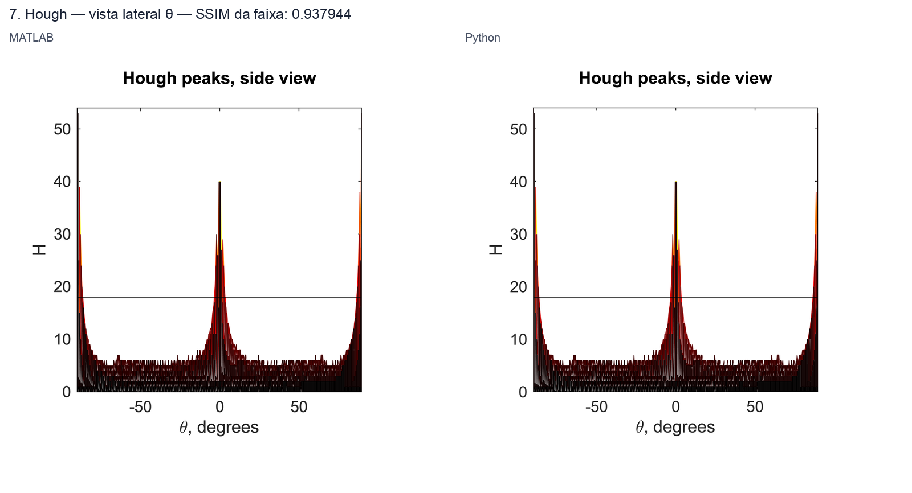

# Avaliação dos sete casos

MATLAB primeiro; Python depois. As notas se referem às regiões originais da auditoria. Os recortes centrais e miniaturas são apenas recursos de inspeção, sem alterar as métricas.

**P20:** a faixa original inclui parte do tick `0,08` do eixo Y. A escala dessa análise muda com a correção Q20 aprovada; esse tick não é parte do título. Em Graphs, marcadores próximos ao topo também podem aparecer na faixa.

[Comparador com zoom e alternância](index.html) · [Procedência e coordenadas](manifest.json)

## 1. Dilatação

SSIM da faixa original: **0.979338**.

[MATLAB — recorte 1:1](01-dilatacao-matlab.png) · [Python — recorte 1:1](01-dilatacao-python.png) · [MATLAB — faixa completa](01-dilatacao-faixa-matlab.png) · [Python — faixa completa](01-dilatacao-faixa-python.png)

## 2. Suscetibilidade de fraturas

SSIM da faixa original: **0.979891**.

[MATLAB — recorte 1:1](02-suscetibilidade-matlab.png) · [Python — recorte 1:1](02-suscetibilidade-python.png) · [MATLAB — faixa completa](02-suscetibilidade-faixa-matlab.png) · [Python — faixa completa](02-suscetibilidade-faixa-python.png)

## 3. CSF

SSIM da faixa original: **0.976113**.

[MATLAB — recorte 1:1](03-csf-matlab.png) · [Python — recorte 1:1](03-csf-python.png) · [MATLAB — faixa completa](03-csf-faixa-matlab.png) · [Python — faixa completa](03-csf-faixa-python.png)

## 4. Graphs — intensidade P21

SSIM da faixa original: **0.972508**.

[MATLAB — recorte 1:1](04-p21-matlab.png) · [Python — recorte 1:1](04-p21-python.png) · [MATLAB — faixa completa](04-p21-faixa-matlab.png) · [Python — faixa completa](04-p21-faixa-python.png)

## 5. Graphs — densidade P20

SSIM da faixa original: **0.972114**.

[MATLAB — recorte 1:1](05-p20-matlab.png) · [Python — recorte 1:1](05-p20-python.png) · [MATLAB — faixa completa](05-p20-faixa-matlab.png) · [Python — faixa completa](05-p20-faixa-python.png)

## 6. Hough — vista lateral ρ

SSIM da faixa original: **0.955917**.

[MATLAB — recorte 1:1](06-hough-rho-matlab.png) · [Python — recorte 1:1](06-hough-rho-python.png) · [MATLAB — faixa completa](06-hough-rho-faixa-matlab.png) · [Python — faixa completa](06-hough-rho-faixa-python.png)

## 7. Hough — vista lateral θ

SSIM da faixa original: **0.937944**.

[MATLAB — recorte 1:1](07-hough-theta-matlab.png) · [Python — recorte 1:1](07-hough-theta-python.png) · [MATLAB — faixa completa](07-hough-theta-faixa-matlab.png) · [Python — faixa completa](07-hough-theta-faixa-python.png)
